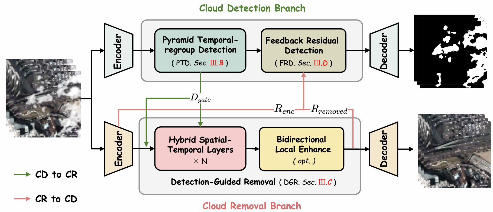
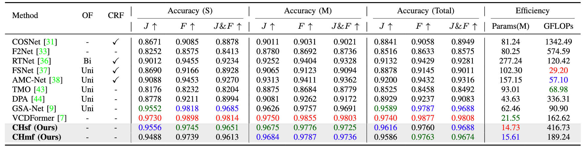
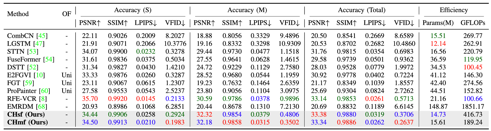
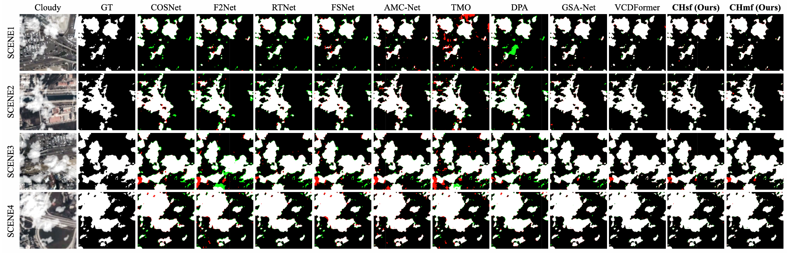
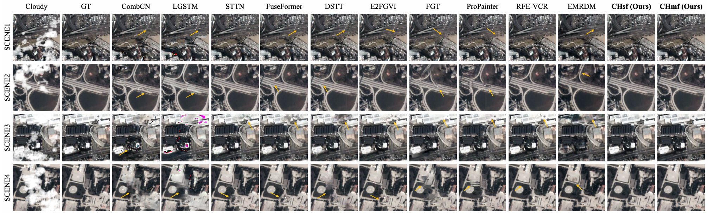

# CloudHandler (TIP 2026)
### 📖[**Paper**](https://ieeexplore.ieee.org/document/11724586)

PyTorch codes for "[CloudHandler: Unifying Satellite Video Cloud Detection and Removal in a Joint Framework](https://ieeexplore.ieee.org/document/11724586)", **IEEE Transactions on Image Processing (TIP)**, 2026.

Authors: Xianyu Jin, [Qiangqiang Yuan*](https://www.sgg.whu.edu.cn/info/1425/2104.htm), [Jiang He*](https://jianghe96.github.io/), [Yi Xiao](https://xy-boy.github.io/), and Liangpei Zhang <br>
Wuhan University, Technical University of Munich, and Zhengzhou University

### Abstract
>Cloud occlusions in satellite videos significantly degrade the visual quality and hinder their utility in downstream applications. To mitigate this issue, cloud detection and removal in satellite videos become vital, which have been scarcely studied yet. Related approaches typically adopt a cloud detection-removal pipeline, which often leads to limited interaction and suboptimal performance. In this paper, we investigate the possibility of simultaneous cloud detection and removal in satellite videos and propose CloudHandler, a novel joint framework to unify the two relevant tasks into a single end-to-end architecture. Elaborate modules are designed to fully explore the inter-frame spatial-temporal information and enable tightly-coupled interactions between the two tasks. Specifically, a lightweight pyramid temporal regroup detection (PTD) block is proposed to perform initial detection at a low computation cost. A detection-guided removal (DGR) block is introduced to leverage detection features as dual guidance to effectively capture and mitigate cloud-affected features. A feedback residual detection (FRD) block is conducted to perform posterior residual compensation to refine the initial
detection features. A cross-domain joint loss is employed to boost training. Furthermore, a new dataset comprising triple image pairs is developed for training, evaluation, and real-world testing. Experiments demonstrate that CloudHandler achieves state-of-the-art performance, exhibiting strong effectiveness, robustness, and generalization ability in both simulated scenarios and long-term real-world satellite videos. The source code will be available at https://github.com/XyJin99/CloudHandler.

### Overall
 

## Environment
> * CUDA
> * Python
> * PyTorch
> * Torchvision
> * causal_conv1d
> * mamba_ssm

We tested our environment compilation under two configurations. For details, please refer to the compilation process for envFor3090.txt (CUDA 11.8 on RTX 3090) and envFor5090.txt (CUDA 12.6 on RTX 5090).

## Dataset Preparation
We improved our previous work [VCDFormer](https://github.com/XyJin99/VCDFormer) to provide a valid benchmark for our joint cloud detection and removal framework.
Please download our dataset in 
 * Baidu Netdisk [WHU-SVideo](https://pan.baidu.com/s/1z9vHvQX6ZcggRydDUV-WJQ) Code: CHds
 * Zenodo: Uploading...
Weights for the two variants (CHsf, CHmf) of CloudHandler are available at
 * Baidu Netdisk [CloudHandler](https://pan.baidu.com/s/1x3-7F8srOKN1tZIxRzXX7g) Code: CHds

## Training
```
python train.py --config=./config/train_model.json
```

## Evaluation
```
python eval.py --config=./config/eval_model.json
```

## Test
```
python test.py --config=./config/test_model.json
```

### Quantitative results
Cloud Detection Comparison
 

 Cloud Removal Comparison
 
 
### Qualitative results
Cloud Detection Comparison
 

 Cloud Removal Comparison
 
#### More details can be found in our paper!

## Contact
If you have any questions or suggestions, feel free to contact me. 😊  
Email: jin_xy@whu.edu.cn

## Citation
If you find our work useful in your research, we would appreciate your citation. 😊😊
```
@article{jin2026cloudhandler,
  title={CloudHandler: Unifying Satellite Video Cloud Detection and Removal in a Joint Framework},
  author={Jin, Xianyu and Yuan, Qiangqiang and He, Jiang and Xiao, Yi and Zhang, Liangpei},
  journal={IEEE Transactions on Image Processing},
  year={2026},
  publisher={IEEE}
}
```

## Our Related Works
If you are interested in our work, here are two related works [VCDFormer] https://www.sciencedirect.com/science/article/pii/S1569843225001128) for satellite video cloud detection, and [RFE-VCR](https://www.sciencedirect.com/science/article/abs/pii/S092427162400248X) for satellite video cloud removal. Our CloudHandler is built upon the foundations of these previous studies. We would greatly appreciate your citation. 😊😊

```
@article{jin2025vcdformer,
  title={VCDFormer: Investigating cloud detection approaches in sub-second-level satellite videos},
  author={Jin, Xianyu and He, Jiang and Xiao, Yi and Lihe, Ziyang and Li, Jie and Yuan, Qiangqiang},
  journal={International Journal of Applied Earth Observation and Geoinformation},
  volume={138},
  pages={104465},
  year={2025},
  publisher={Elsevier}
}

@article{jin2024rfe,
  title={RFE-VCR: Reference-enhanced transformer for remote sensing video cloud removal},
  author={Jin, Xianyu and He, Jiang and Xiao, Yi and Lihe, Ziyang and Liao, Xusi and Li, Jie and Yuan, Qiangqiang},
  journal={ISPRS Journal of Photogrammetry and Remote Sensing},
  volume={214},
  pages={179--192},
  year={2024},
  publisher={Elsevier}
}
```
## Acknowledgement
Our work is built upon [MambaIR](https://github.com/csguoh/MambaIR). Thanks to the author for sharing this awesome work!
